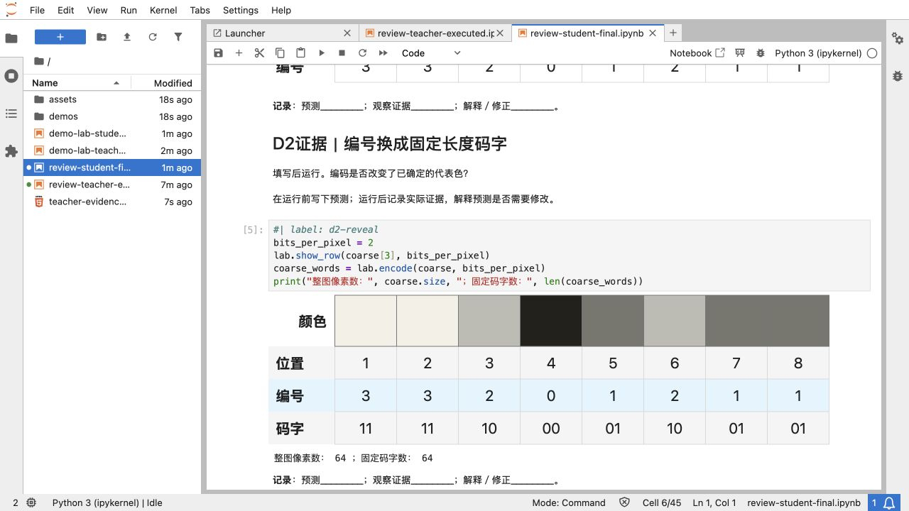
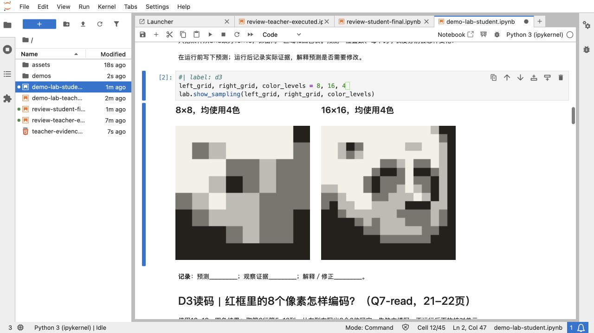
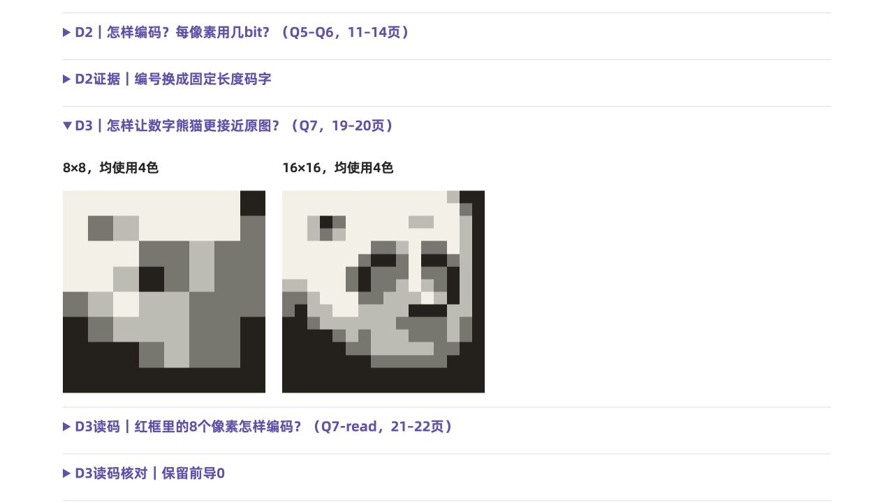

# 熊猫图像编码Notebook｜两轮审查与修正

日期：2026-10-11。范围：冻结85页定稿的Notebook配套、运行说明、共同计算模块、离线结果与便携包。

冻结课件：`1-2-3-image-encoding-panda-v4-20261011.pptx`，SHA-256 `aa2661338514e717294236bdad42c0bbba8acfa370148a53f9c89ab156c1521b`。开始、内核执行前后与交付时均核对相同；未调用PPTX生成器，未改动该文件。

## 交付与用法

- 两份干净Notebook各45个单元，其中22个代码单元；D1–D12覆盖采样、量化、码字、容量、数据量、RGB、放大、解码、连续／离散及预算。另有T1/T2/T3a/T3b/T4总结与E1独立评价。
- 课堂投影学生版，教师版含答案仅供备课／私下参考；先预测、逐单元运行，不Run All。E1先提交再启用反馈，文件理由人工评价。
- 教师／学生ZIP在`../../exports/notebooks-20261011/`；教师离线结果为`../../fallback/teacher-evidence.html`。学生包无教师Notebook、答案说明、离线结果或执行副本。
- [运行、页码对应、依赖和复制说明](../../README-notebooks-20261011.md)。完整实验为另加课时／课后材料；45分钟主路径只选短操作替代证据讲解，仍需实测节奏。

## 第一轮：构建、算法与信息分层

P0：未发现。P1阻断构建或允许不成立的技术条件；P2影响呈现或证据保存。

|编号／级别|发现的问题与影响|修正|核验与状态|
|---|---|---|---|
|R1-01 / P1|Quarto转换结果为nbformat 4.4；加入cell id后校验失败，不能交付Notebook。|生成器将minor提升到至少5，分配稳定ID并验证schema。|nbformat.validate、两份Notebook构建通过；fixed。|
|R1-02 / P1|PNG接受小数编号／码表外编号；decode缺少颜色数与码宽的一致性检查。错误参数会被截断或产生不成立的证据。|验证整数矩阵、范围、调色板成员与容量；PNG选择合法1/2/4/8位。|新增5项负例／PNG五色用4位检查，均通过；fixed。|
|R1-03 / P2|QMD frontmatter出现在学生首页，混入格式配置。|转换后只移除首单元的源元数据，不删教学标题或问题。|两版no_visible_frontmatter通过；fixed。|
|R1-04 / P2|内核失败时已完成的断言没有保存到检查报告，难以区分算法错误与环境阻塞。|异常时保存execution-failure.json与部分执行Notebook。|round1-after保存实际PermissionError及先完成的断言；随后新内核重跑通过；fixed。|

首次内核启动受到沙箱本地端口限制（PermissionError）。保留`round1-after/`失败证据后，使用获准的本地内核执行重新检查；不是顺序exec代码的替代检查。`round1-kernel/checks.json`记录**57项pass、0 fail**，教师／学生各22个代码单元从新内核执行。初次构建错误另记于`round1-review.json`；失败试验不作为验收结果。

## 第二轮：课堂呈现、独立评价、复制与离线

P0：未发现。以下问题按P1、P2排序，全部修正。

|编号／级别|问题与影响|修正|核验与状态|
|---|---|---|
|R2-01 / P1|教师版下一个问题的答案会出现在证据下方，同屏滚动有泄露风险。|改为投影无教师答案段落的学生版；教师版仅备课/私下参考。|ui-rgb-final.jpg：下一题只有问题与任务；student_no_teacher_blocks检查通过。 fixed。|
|R2-02 / P1|E1填写变量后仍只打印提示，没有完成后的核对流程。|增加submitted开关；四项填全且提交后才给三个计算项诊断；自由文本理由人工评价。|E1反馈四项断言；student-completed-portable-executed.ipynb实际填写并成功核对。 fixed。|
|R2-03 / P1|课程入口仍称当前77页且Notebook不适用，可能用错85页定稿及总结时点。|C0/C6登记冻结版、Notebook源与输出；C5注明共同熊猫矩阵，记录T3a/T3b/T4及KB/KiB对应。|course-design.qmd差异审查；README的85页对应表、主路径时长与分发说明。 fixed。|
|R2-04 / P2|RGB输出含np.float64/np.uint8字样，表格换行；逐格读码竖表高。|递归格式化数字；颜色、位置、编号、码字改为横向对齐。|ui-rgb-final.jpg和ui-row-final.jpg复查，display_hides_numpy_types通过。 fixed。|
|R2-05 / P2|D3调用没有显式可改参数，不利于控制变量操作。|把left_grid/right_grid/color_levels置于当前单元；相同颜色与区域由共用函数保持。|JupyterLab新内核只运行准备→D3，两个结果同屏；ui-live-sampling.jpg。 fixed。|
|R2-06 / P2|离线结果与分角色便携包尚未生成，复制完整目录的边界不明确。|生成默认折叠的教师离线HTML，分别封装教师/学生ZIP；记录最小演示顺序与依赖。|独立目录的完整学生路径通过；ZIP CRC/哈希及学生包排除教师文件通过。 fixed。|
|R2-07 / P2|总结的ASCII下划线在Markdown中被解析为强调，书写空间标记消失。|改为全角书写线；重生成干净Notebook，执行最终版本。|源/输出文本一致；round2-final fresh-kernel与清空输出检查通过。 fixed。|

第二轮修正后`round2-after/checks.json`为69项pass；书写线和说明收尾后重生成，再执行`round2-final/checks.json`，仍为**69项pass、0 fail**。两版正常路径分别启动新内核；第三个新内核在独立临时课堂目录跑学生完成路径：改变为2×4解码、填写并提交E1，断言模块确实从复制目录导入。执行副本保留在该轮目录。

## 验收记录

|层次|状态|方法、证据与边界|
|---|---|---|
|冻结保护|pass|冻结PPTX与原图哈希在计算前后及最后一致；frozen-deck.json为读取快照，不是新课件。|
|教学对应|pass|逐实验核对85页当前题面、Notes、表格与新增概念图，README记录Q／页码／证据／阶段。8×8第四行与16×16选段不混同，解码允许多种尺寸；保留分段总结。|
|版本差异|pass|77页生成版仍保留；course-design C0/C6登记85页冻结版与配套角色。冻结版56–57页先颜色表示，61–62页后解码，76页综合示意；不套用旧T3/T4页号。|
|单位与技术边界|pass|课件KB÷1024对应Notebook KiB，数值不变。平均色取未取整值；RGBA／JPEG字节／真实物理采样不混同。五色3bit教学模型与真实PNG位数分开。|
|独立数值检查|pass|从原JPEG用Pillow逐像素取值、纯Python求和／寻找最小距离，独立于NumPy分块算法；核对现有Tk数据、两条像素行、Q15 RGB、16/64/96B、499500B、32B方案、E1 45B。|
|PNG精确读回|pass|在内存中保存／打开真实索引PNG，分别比较编号数组与RGB数组完全相等；目标是已量化记录，不是原图或自然光。当前四色情况PNG为164B，编码器变化允许该长度改变。|
|源／输出及语言|pass|QMD源hash、Notebook正文digest、schema、清空输出／计数；Python注释与docstring英语。中文字符串为界面、教学提示与学生完成路径测试数据。|
|新内核执行|pass|Python 3.11.16（shtick）；教师、学生正常路径与学生完成／独立目录路径。单元timeout60秒、startup60秒，不允许错误继续。详细软件版本见round2-final/checks.json。|
|本机JupyterLab阶段操作|pass（限定）|JupyterLab 4.6.3，Codex浏览器1280×720；干净学生副本只执行准备→D3成功，两图同屏；查看执行证据的RGB和横向码字表。未逐一在浏览器手动执行全部22个单元，完整运行由nbclient验证。|
|离线HTML|pass|22组证据默认折叠，无外部资源；独立浏览器预览展开D3。Jupyter /files入口出现origin拒绝后，使用独立静态预览；没有改变Jupyter安全设置。课堂直接双击HTML，使用浏览器。|
|便携包|pass|ZIP CRC、成员hash、学生干净输出及角色排除通过，见archive-checks.json。初稿包及其hash保留于round2-before-packaging，不是正式交付。|
|课程入口文档|pass（有提示）|课程设计Quarto HTML已渲染；原lang zh-CN产生两条翻译提示，输出成功。此次仅同步入口、文件角色和配套阶段，不声称重建PPTX／Reveal／Tk或原活动单。|
|Windows/JupyterLab目标环境|unverified|本机macOS检查不能证明Windows依赖、内核选择、路径及参数运行；课前用准备→D3→D4→D10在目标环境确认。|
|实际投影与班级时长|unverified|检查为浏览器屏幕，不是后排、投影色差或学生完成速度；完整实验与短替代操作均为计划时长。|
|WPS／PowerPoint、旧Reveal／Tk验收|未重新检查|本任务冻结PPTX并生成配套，未修订／重验这些应用与历史输出；不把旧77页证据算作85页冻结版的验收。|

## 重复检查与写入边界

课程目录运行，使用安装了requirements-notebook-checks.txt的Python及Quarto：

```bash
python scripts/build-panda-notebooks.py
python scripts/check-panda-notebooks.py --round new-check-name
python scripts/export-panda-notebook-kit.py --evidence new-check-name
```

构建只写两份IPYNB，正文人工编辑／保存输出时拒绝覆盖。检查写新轮次的独立执行副本，已有轮次拒绝覆盖；导出写离线HTML与角色ZIP，已有ZIP拒绝覆盖。再次导出前保留旧包及hash。课堂不需要构建器和验收器。此任务未提交Git或发布。

## 本机显示证据







技术来源及检索日期见README教师参考：Pillow Concepts、W3C PNG第三版§11.2.1、NIST二进制前缀、NBClient执行文档。生成图像分类不适用：本任务没有AI图片，示意曲线由明确函数生成，熊猫图从原资产计算。
